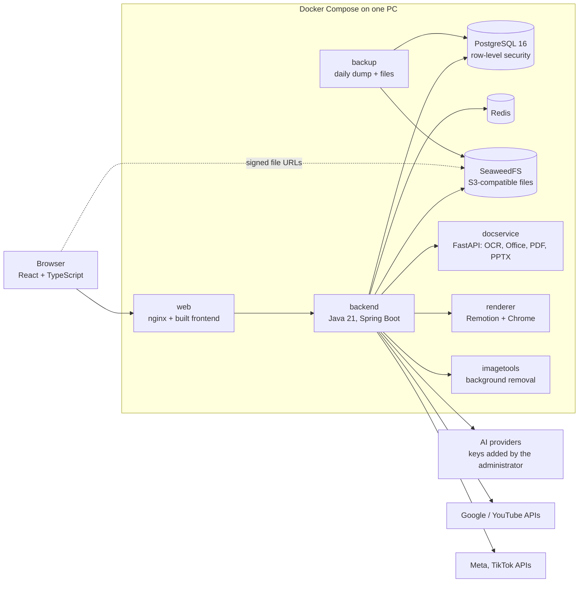
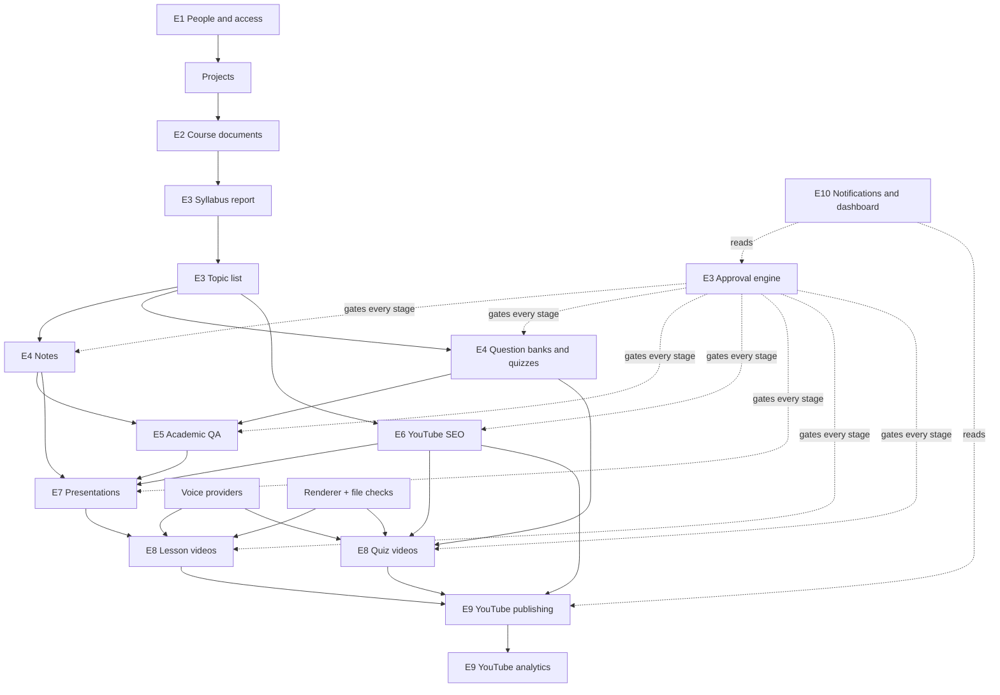
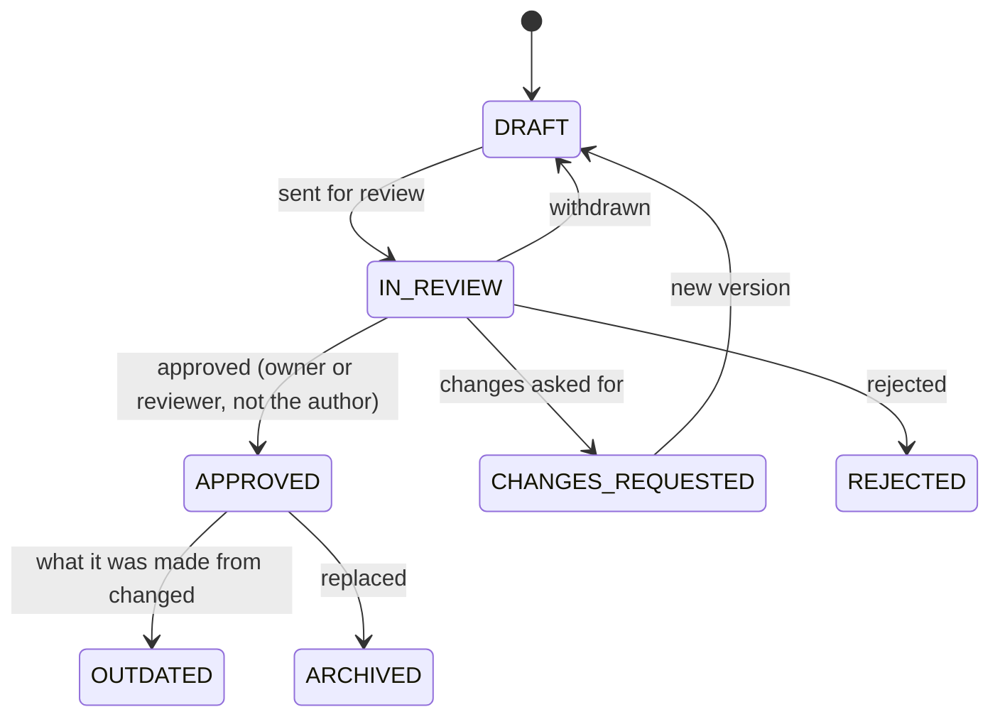
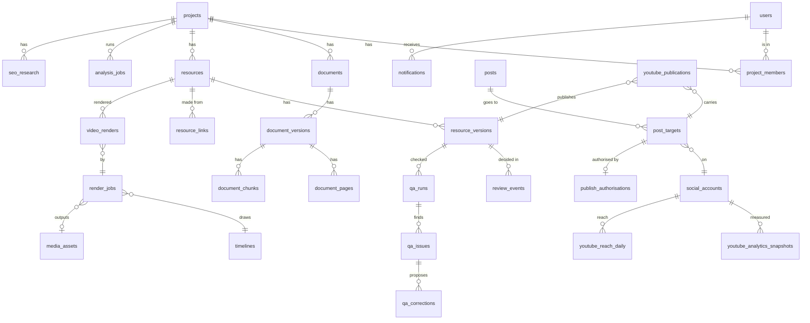

# Leenax Studio architecture

Leenax Studio is a private installation for at most five people. It turns university course material into checked notes, question banks, QA reports, SEO reports, presentations and narrated videos, and publishes approved videos to YouTube. A creator workspace (AI video, editor, social publishing) shares the same app.

## The pieces



- **One backend (a modular monolith).** Each feature is a Java package with its own controller, service and SQL store. Background work (AI jobs, renders, uploads, analytics imports) runs in the same process: jobs are rows in PostgreSQL, claimed with `FOR UPDATE SKIP LOCKED`, so a restart picks them up again.
- **Private helper services.** The document service and the renderer listen only on the Docker network. Neither holds keys.
- **Secrets stay on the server.** Provider keys and social sign-ins are encrypted with `LEENAX_MASTER_KEY` and never returned to the browser.

## Who sees what

The database decides, not just the app. Every request runs as the signed-in person (`ActorDataSource` sets `leenax.user_id` and `leenax.mode` on the connection), and row-level security policies use those values.

| Mode | Who | Sees |
|---|---|---|
| `user` | a signed-in member | projects they're a member of, their own creator work |
| `admin` | a signed-in administrator | everything |
| `worker` | background jobs | everything, but can't approve or authorise |
| `system` | start-up and maintenance | everything |

Project roles: **Owner**, **Editor**, **Reviewer**, **Viewer**. Approval rules ("the reviewer is not the author", "only owners and reviewers decide", "AI jobs can't approve") and publishing rules ("nothing uploads without an authorisation record") are database triggers, so no code path can skip them. Their error codes (`LX0xx`) are mapped to plain messages in `SqlStates`.

## Modules and what they depend on



## The approval workflow



Gates checked when a version is approved:

| Stage | Needs | Code |
|---|---|---|
| Topic analysis | an approved topic list | LX024 |
| Notes, question banks, QA reports | no open critical QA issue (for a report, on what it covers) | LX014 |
| Presentation | approved notes, QA report and SEO report | LX017 |
| Lesson video | an approved presentation | LX018 |
| Quiz video | an approved MCQ set and SEO report | LX018 |
| Any video | a render of exactly this content that passed its file checks | LX019 |
| YouTube upload | an authorisation record of exactly this file and these settings | LX020 |
| Public post | the public confirmation | LX021 |
| Education publication | the owner or an administrator, the approved version, its checked render, rights confirmed | LX022 |

**Automation (E11, V19).** An `AFTER INSERT OR UPDATE OF status` trigger on `resource_versions` looks at the project's `topic_automation` row when a version becomes approved, and queues the next AI job in `analysis_jobs` (`auto = true`, `created_by` = the approver): topic list → topic analyses; analysis → notes; notes, QA, SEO → questions and presentation once their inputs are approved. It never queues work of a kind that already exists for the topic, and the unique running-job index stops duplicates. The jobs are run by the same worker as hand-started ones, so the approval gates and drafts apply unchanged.

## Main tables



`resources` is one piece of approvable work (a syllabus report, a topic list, notes for a topic and level, a question bank, a QA report, an SEO report, a presentation, a lesson or quiz video). Its content lives in `resource_versions` as JSON with a SHA-256 hash; a version can't change once it leaves draft.

## Folders

```
backend/          Spring Boot app; db/migration has V1..V18 (Flyway)
  src/test/java   unit tests (no database)
  src/test/sql    SQL suites against a real PostgreSQL (run_all.sh)
frontend/         React + Vite; src/pages, src/components, src/lib (API types and queries), src/remotion (video templates)
renderer/         Remotion render service
docservice/       FastAPI document service (OCR, Office conversion, exports)
imagetools/       image helper service
deploy/, scripts/ backups, restore, HTTPS example
docs/             API, checklist, this file, guides, acceptance
.github/workflows CI
```

## Why these choices

- **Java and Spring Boot**, kept from the first phases: typed, well-supported HTTP and JSON clients for each provider, and transactions around every state change.
- **PostgreSQL** with row-level security and triggers: the rules that protect people's work hold even if application code is wrong, and JSONB keeps versioned content in one place.
- **Jobs in PostgreSQL, not a queue server:** five users don't need one, and work survives restarts.
- **SeaweedFS:** S3-compatible files on the same PC, with signed URLs so the browser fetches media directly.
- **Remotion:** the editor's preview and the final render use the same templates.
- **No paid service is assumed.** Every AI or Google integration is used only when the administrator connects it, with its cost shown where the provider reports one.
